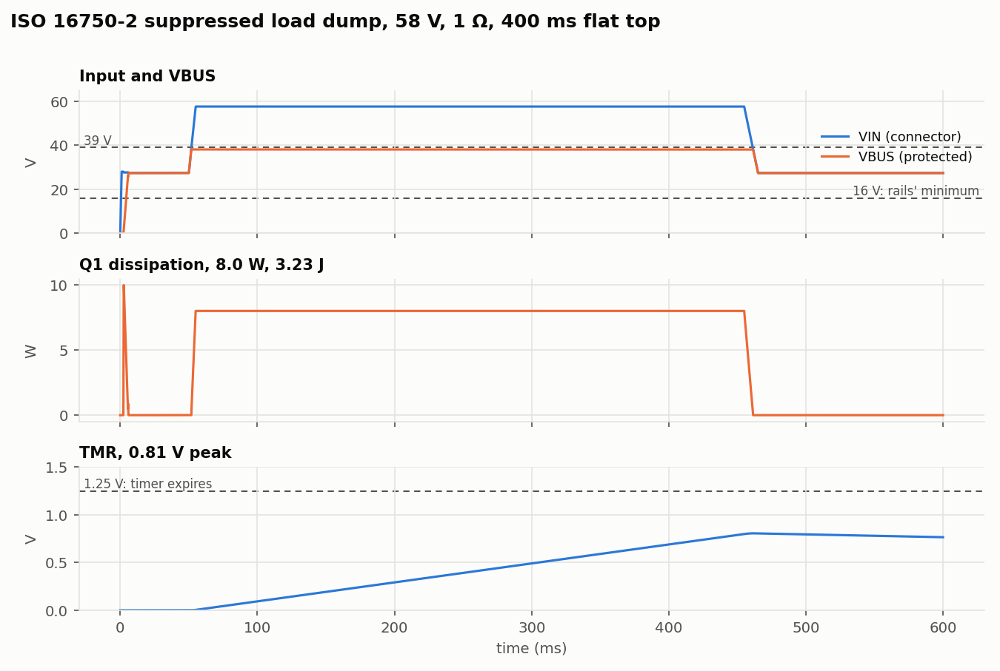
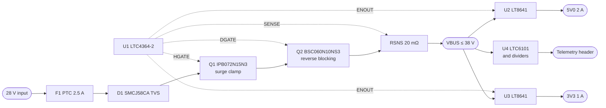
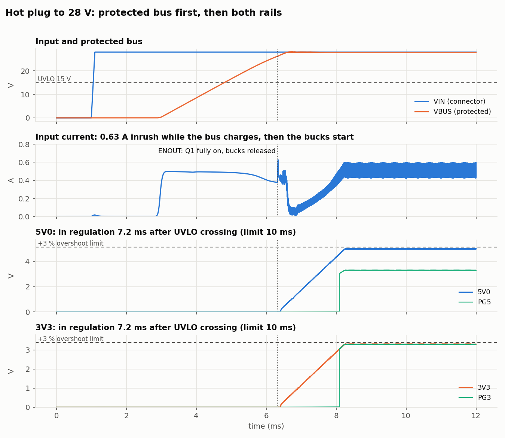
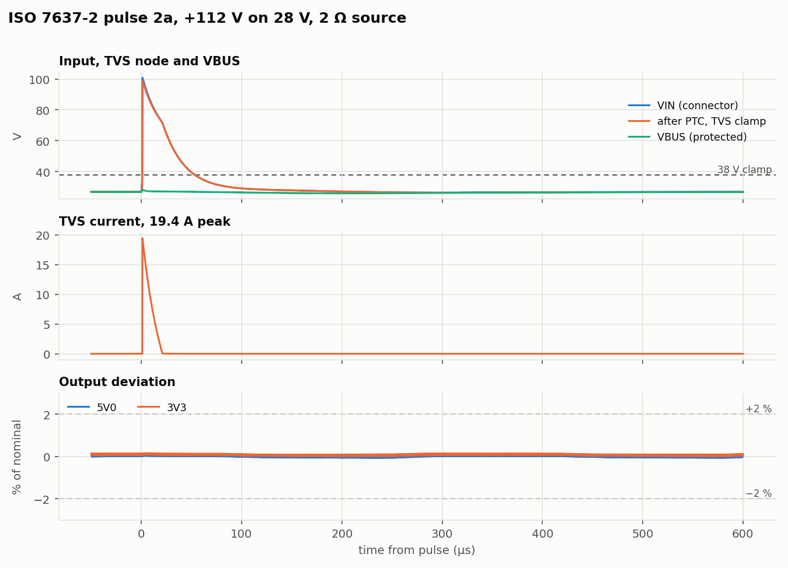
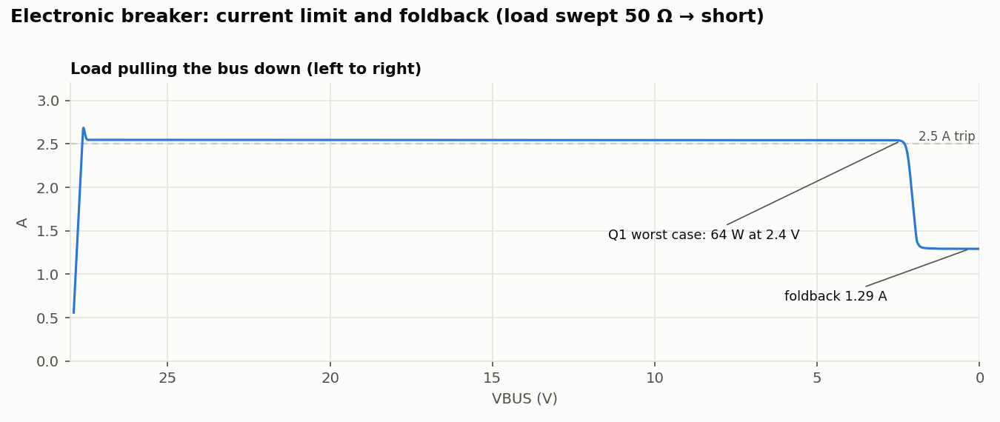
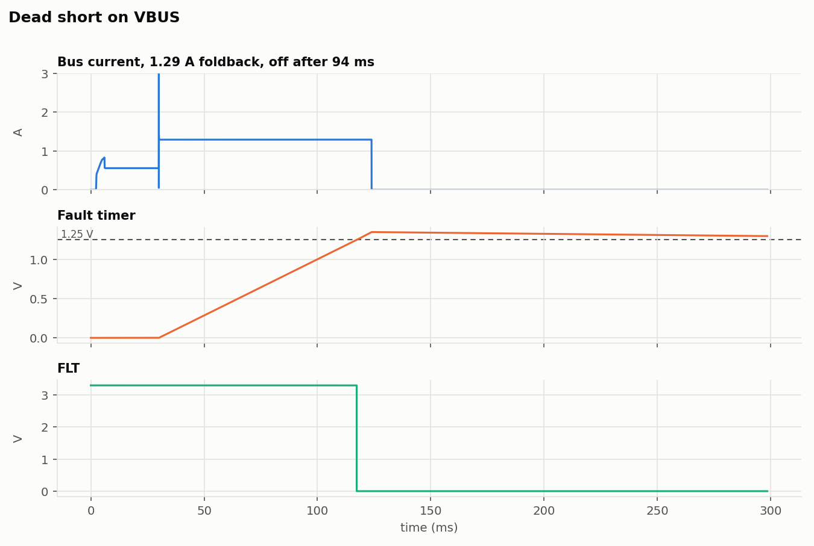
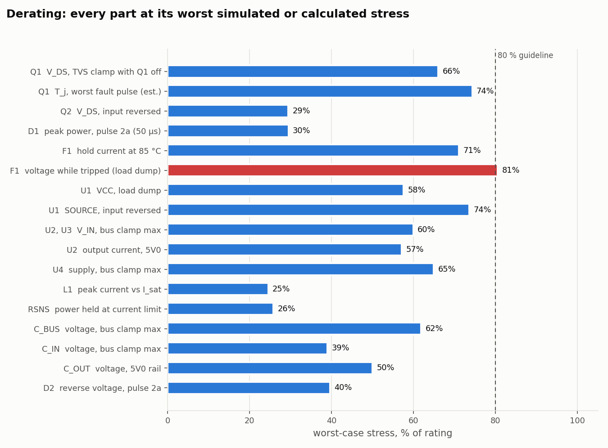

# PM28: protected 28 V to 5 V / 3.3 V power module

Power module for a 28 V vehicle or industrial bus. Outputs 5 V at 2 A and 3.3 V
at 1 A for a microcontroller and its peripherals. Input protection covers
reverse polarity, ISO 16750-2 load dump, ISO 7637-2 pulse 2a and output
short circuits. A telemetry header reports bus voltage, input current, rail
voltages and fault status.

Status: design complete and verified in LTspice with manufacturer models for
every IC and FET. Schematic capture, layout and hardware are not done yet.

<p align="center"></p>

## Results

40 of 40 simulated checks pass across ten LTspice benches. All parts are at or
below 80 % of rating except the PTC voltage rating in a fault-on-fault case (81 %).

| Requirement | Spec | Simulated | Result |
|---|---|---|---|
| Load dump, 58 V / 1 Ω / 400 ms | bus clamped 38 V ± 1 V, rails in regulation | bus 38.09 V; fault timer 0.81 V of 1.25 V | Pass |
| ISO 7637-2 pulse 2a, 140 V peak | no damage, rails in regulation | bus peak 28.3 V; rails within 0.16 % | Pass |
| Reverse polarity, -30 V | no damage, < 15 mA | 10.1 mA, bus at 0 V | Pass |
| Turn-on threshold | 15 V ± 1 V | 15.59 V on, 14.97 V off | Pass |
| Electronic breaker | 2.5 A ± 20 %, foldback, auto-retry | 2.54 A, 1.29 A into a short, retry every 260 s | Pass |
| 5V0 / 3V3 accuracy | ± 2 % | 5.001 V / 3.303 V; worst case 1.10 % over 16-38 V input | Pass |
| Ripple | < 20 mVpp | 7.7 mVpp / 4.7 mVpp | Pass |
| Load step 25-100 % in 1 µs | < ± 5 %, settled < 200 µs | 5V0 4.07 %, 53 µs; 3V3 2.64 %, 37 µs | Pass |
| Startup | ≤ 10 ms after UVLO, ≤ 3 % overshoot, after input switch | 7.16 ms, +0.16 %, bucks enabled 0.12 ms after ENOUT | Pass |
| Output short | indefinite, recovers | both rails recover within 70 µs | Pass |
| Efficiency, 28 V, full load | ≥ 85 % | 94.9 % (model is optimistic, 88-90 % expected) | Pass |
| Telemetry | 0-3.3 V outputs | IIN_MON error < 0.1 %, highest pin 2.50 V | Pass |

All 40 checks: [sim/results.md](sim/results.md). Method, figures and model
limitations: [docs/03-simulation.md](docs/03-simulation.md).

## Block diagram



| Function | Implementation |
|---|---|
| Surge (load dump) | LTC4364 runs Q1 in linear mode and regulates VBUS to 38 V. Loads stay powered for the full 400 ms. |
| Fast transients (pulse 2a) | D1 clamps the input. The LTC4364 turns Q1 down within 1 µs, so VBUS does not follow. |
| Reverse polarity | Q2, driven by the LTC4364 as an ideal diode, blocks reverse current. |
| Overcurrent | 2.5 A limit on RSNS, foldback to 1.3 A below 2.4 V, fault timer, auto-retry. F1 is a backup. |
| Rails | Two LT8641 synchronous bucks at 1 MHz. Enabled by ENOUT after Q1 is fully on, so inrush and soft-start do not overlap. |
| Telemetry | LTC6101 high-side current sense and resistor dividers, all scaled to 0-3.3 V. |

## Figures

| | |
|---|---|
|  |  |
| Hot plug to 28 V | ISO 7637-2 pulse 2a |
|  |  |
| Current limit and foldback | Dead short, fault timer and FLT |
|  |  |
| Load steps and 16-38 V line ramps | Derating |

## Changes from Rev A

Simulation against the vendor models led to these changes to the hand-calculated design:

1. Q1 changed from IPD200N15N3 (DPAK) to IPB072N15N3 (D²PAK). A partial short
   that holds VBUS just above the foldback point dissipates about 64 W in Q1 for
   100 ms. Estimated junction temperature: 193 °C for the DPAK, 130 °C for the D²PAK.
2. C_TMR set to 6.8 µF. The same capacitor sets the load-dump ride-through and
   the overcurrent cut-off time.
3. LT8641 feedback reference corrected from 0.800 V to 0.809 V. Feedback
   dividers changed to E192 0.1 % values.
4. C_FF increased from 4.7 pF to 22 pF. The 5 V load step was -6.1 % / +6.4 %.
5. Pulse 2a modelled as 112 V on top of the 28 V bus (140 V peak). TVS peak
   current is 19.9 A.

See [docs/03-simulation.md](docs/03-simulation.md#what-simulation-changed).

## Repository

| Path | Contents |
|---|---|
| [`docs/01-spec.md`](docs/01-spec.md) | Requirements (Rev B) |
| [`docs/02-part-selection.md`](docs/02-part-selection.md) | Part selection |
| [`docs/03-simulation.md`](docs/03-simulation.md) | Simulation method and results |
| [`docs/04-derating.md`](docs/04-derating.md) | Derating sheet |
| [`calc/sizing.py`](calc/sizing.py) | Component values from the spec, writes `sizing.json` |
| [`calc/derating.py`](calc/derating.py) | Derating table and chart |
| [`sim/run.py`](sim/run.py) | Netlist generation, LTspice runs, measurements, plots |
| [`sim/*.cir`](sim) | Generated LTspice netlists |

## Reproducing

Requires [LTspice](https://www.analog.com/ltspice) 24 or newer and Python 3.10+
with numpy and matplotlib.

```sh
python calc/sizing.py
python sim/run.py
python calc/derating.py
```

`sim/run.py` takes about 10 minutes. Set `LTSPICE` if LTspice is not in its
default install location.

## Remaining work

- Schematic and PCB in KiCad (4-layer, 60 × 40 mm or smaller)
- STM32 telemetry firmware (scale factors are in `calc/sizing.json`)
- Hardware validation, including conducted EMI and thermal
