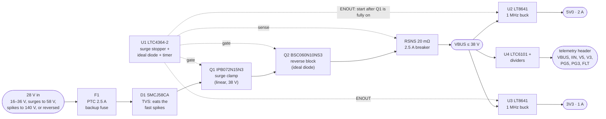
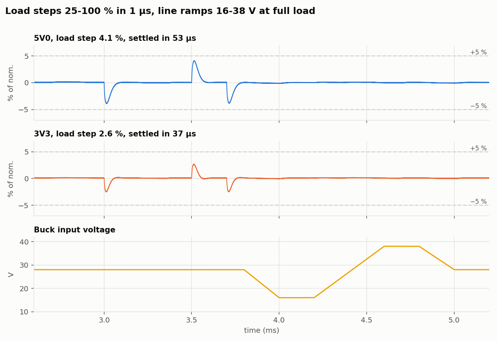

# PM28: protected 28 V → 5 V / 3.3 V power module

A small board that takes a dirty 28 V vehicle/industrial bus and hands clean
5 V (2 A) and 3.3 V (1 A) rails to a microcontroller. It survives being wired
backwards, rides through load dumps and ISO 7637-2 spikes, trips like a breaker
on a short, and reports its own health over a telemetry header.

**Status: designed and verified in simulation, not yet built.** Every line of
the spec that can be checked before hardware exists has been run in LTspice
against the manufacturers' own models of every IC and FET.

<p align="center"></p>

## Results

**40 / 40 simulated checks pass** across ten LTspice benches. Derating: every part sits at or under 80 % of its rating, except the PTC's voltage rating in a fault-on-fault case (81 %).

| Requirement | Spec | Simulated | |
|---|---|---|---|
| Load dump, 58 V / 1 Ω / 400 ms | bus clamped 38 V ± 1 V, rails in regulation | bus 38.09 V; fault timer 0.81 V of 1.25 V | ✅ |
| ISO 7637-2 pulse 2a, 140 V peak | no damage, rails in regulation | bus peaks at 28.3 V; rails move ≤ 0.16 % | ✅ |
| Reverse polarity, −30 V | no damage, < 15 mA | 10.1 mA, bus stays at 0 V | ✅ |
| Turn-on threshold | 15 V ± 1 V | 15.59 V on, 14.97 V off | ✅ |
| Electronic breaker | 2.5 A ± 20 %, folds back, auto-retry | 2.54 A → 1.29 A into a short, retries every 260 s | ✅ |
| 5V0 / 3V3 accuracy | ± 2 % | 5.001 V / 3.303 V; worst 1.10 % over 16–38 V in | ✅ |
| Ripple | < 20 mVpp | 7.7 mVpp / 4.7 mVpp | ✅ |
| Load step 25 → 100 % in 1 µs | < ± 5 %, settled < 200 µs | 5V0 4.07 %, settled in 53 µs; 3V3 2.64 %, settled in 37 µs | ✅ |
| Startup | ≤ 10 ms after UVLO, ≤ 3 % overshoot, after the input switch | 7.16 ms, +0.16 % overshoot, bucks start +0.12 ms after ENOUT | ✅ |
| Output short | indefinite, recovers | both rails back in ≤ 70 µs | ✅ |
| Efficiency, 28 V, full load | ≥ 85 % | 94.9 % (the model runs optimistic; expect 88–90 %) | ✅ |
| Telemetry | safe for a 3.3 V MCU pin | IIN_MON error < 0.1 %, highest pin 2.50 V | ✅ |

All 40 individual checks: [sim/results.md](sim/results.md).

Full method, every figure and the modelling caveats: [docs/03-simulation.md](docs/03-simulation.md).

## How it works



- **Surges** are clamped *linearly*: the LTC4364 runs Q1 as a source follower
  that holds the bus at 38 V, so the loads ride through a 400 ms load dump
  instead of being disconnected.
- **Fast spikes** (ISO 7637-2 pulse 2a, 140 V peak) are taken by the TVS. The
  controller pulls Q1's gate down in under a microsecond, so they never reach
  the bus.
- **Reverse polarity** is blocked by Q2, a back-to-back FET the LTC4364 drives
  as an ideal diode.
- **Shorts** hit a 2.5 A current limit that folds back to 1.3 A, then a fault
  timer turns Q1 off and retries every 260 s. The PTC is a backup for faults
  the breaker can't see.
- **The rails** are two LT8641 Silent Switcher bucks at 1 MHz, the same part on
  both. They only start once the input switch is fully on (ENOUT), so inrush
  and soft-start never stack.

## Figures

| | |
|---|---|
|  |  |
| **Hot plug.** Bus ramps first, then both rails soft-start. | **ISO 7637-2 pulse 2a.** 140 V peak, the rails don't notice. |
|  |  |
| **Breaker.** 2.5 A limit, folds back into a short. | **Dead short.** Limit, time out, FLT to the MCU. |
|  |  |
| **Load steps and 16–38 V input** at full load. | **Derating.** Every part at its worst case. |

## What simulation caught

Simulating against the vendor models before layout changed five things in the
hand-calculated Rev A design:

1. **Q1 was too small.** The worst case isn't the load dump or a dead short. It's
   a partial short that holds the bus just above the foldback point, putting
   ~64 W into Q1 for ~100 ms. Q1 moved from a DPAK to a D²PAK with a 3× larger die.
2. **The fault timer** serves both the 400 ms load-dump ride-through and the
   short-circuit cut-off. 6.8 µF is the value that satisfies both.
3. **The LT8641's FB reference** is 0.809 V, not the 0.800 V back-solved from a
   demo circuit, which would have put both rails 1.1 % high.
4. **The 5 V load step** overshot ±5 %. More feed-forward capacitance (22 pF) fixed it.
5. **Pulse 2a** sits *on top of* the 28 V bus. The TVS sees 19.9 A, not 11.8 A.

Details in [docs/03-simulation.md](docs/03-simulation.md#what-simulation-changed).

## Repository

| Path | What's there |
|---|---|
| [`docs/01-spec.md`](docs/01-spec.md) | One-page requirements (Rev B) |
| [`docs/02-part-selection.md`](docs/02-part-selection.md) | Every part and why it was picked |
| [`docs/03-simulation.md`](docs/03-simulation.md) | The LTspice suite, all results and figures |
| [`docs/04-derating.md`](docs/04-derating.md) | Worst-case stress on every part vs. its rating |
| [`calc/sizing.py`](calc/sizing.py) | Spec → component values (writes `sizing.json`) |
| [`calc/derating.py`](calc/derating.py) | Stress table and chart from sizing + simulation |
| [`sim/run.py`](sim/run.py) | Builds the netlists, runs LTspice, measures, plots |
| [`sim/*.cir`](sim) | Generated netlists, open them in LTspice |

## Reproduce

Needs [LTspice](https://www.analog.com/ltspice) 24 or newer (the vendor models
ship with it) and Python 3.10+ with numpy and matplotlib.

```sh
python calc/sizing.py      # component values from the spec
python sim/run.py          # ten LTspice benches, ~10 min, writes sim/results.* and docs/img/
python calc/derating.py    # derating table and chart
```

Set `LTSPICE` if LTspice isn't at its default install path.

## Not done yet

- **Schematic and PCB** (KiCad, 4-layer, ≤ 60 × 40 mm).
- **STM32 telemetry firmware.** Scale factors are already in `calc/sizing.json`.
- **Hardware.** Conducted EMI, thermals and every number above get re-measured on a real board.
