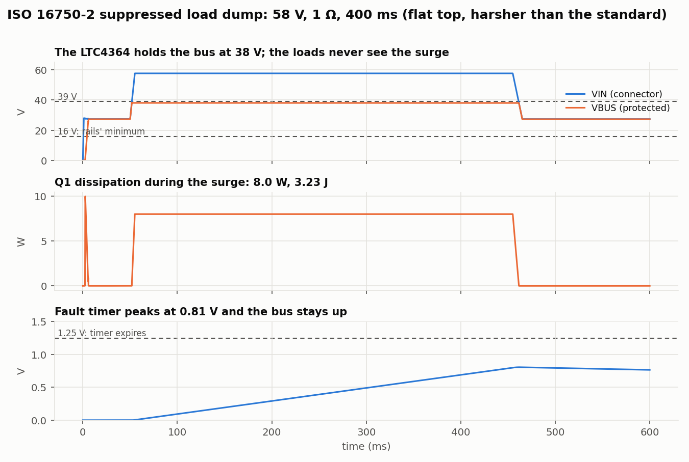
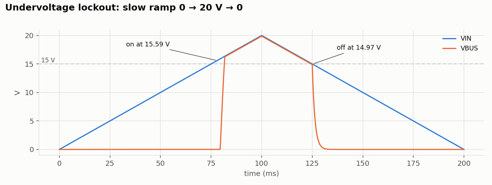
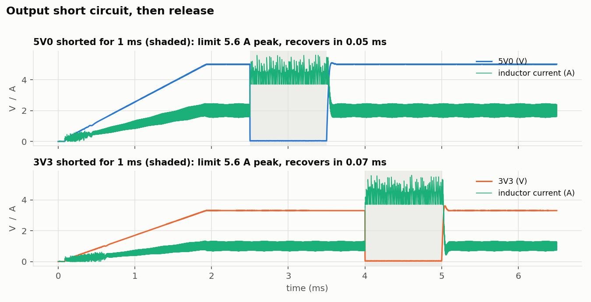

# Simulation

Every line of [the spec](01-spec.md) that can be checked before hardware exists
is checked here, in LTspice, against Analog Devices' own models of the LTC4364-2,
LT8641 and LTC6101 and Infineon's models of both FETs. The suite is one script:

```
python sim/run.py            # all ten benches, ~10 min on a laptop
python sim/run.py loaddump   # one bench
```

It builds each netlist from `calc/sizing.json` (so a resistor changed in
`calc/sizing.py` is the resistor that gets simulated), runs LTspice in batch
mode, measures the waveforms against the spec and writes
[`sim/results.md`](../sim/results.md), [`sim/results.json`](../sim/results.json)
and the figures below. The `.cir` netlists are committed; open any of them in
LTspice to poke at it.

## Results

| Area | Check | Simulated | Limit | |
|---|---|---|---|---|
| Startup | 5V0 in regulation after UVLO crossing | 7.16 ms | ≤ 10 ms | ✅ |
| Startup | 5V0 overshoot | +0.09 % | ≤ 3 % | ✅ |
| Startup | 5V0 monotonic (largest dip during rise) | 11.8 mV | ≤ 1 % of rail | ✅ |
| Startup | 5V0 starts after input switch is fully on | +0.12 ms after ENOUT | after ENOUT | ✅ |
| Outputs | 5V0 ripple at full load | 7.7 mVpp | < 20 mVpp | ✅ |
| Outputs | 5V0 DC at 28 V, full load | 5.001 V | 5.00 V ± 2 % | ✅ |
| Startup | 3V3 in regulation after UVLO crossing | 7.15 ms | ≤ 10 ms | ✅ |
| Startup | 3V3 overshoot | +0.16 % | ≤ 3 % | ✅ |
| Startup | 3V3 monotonic (largest dip during rise) | 20.3 mV | ≤ 1 % of rail | ✅ |
| Startup | 3V3 starts after input switch is fully on | +0.11 ms after ENOUT | after ENOUT | ✅ |
| Outputs | 3V3 ripple at full load | 4.7 mVpp | < 20 mVpp | ✅ |
| Outputs | 3V3 DC at 28 V, full load | 3.303 V | 3.30 V ± 2 % | ✅ |
| Outputs | Efficiency, 28 V in, both rails full load | 94.9 % (13.31 W / 14.02 W) | ≥ 85 % | ✅ |
| Input | Inrush peak (bus caps charging) | 0.63 A | < 2.5 A breaker | ✅ |
| Telemetry | IIN_MON reading vs actual bus current | 0.500 A vs 0.500 A (-0.0 %) | ± 3 % | ✅ |
| Telemetry | Highest voltage on any telemetry pin | 2.50 V | ≤ 3.3 V (+0.3 V) | ✅ |
| Input | Pulse 2a: TVS clamp (FET drain) | 98.9 V, 19.4 A peak | Q1 ≤ 150 V | ✅ |
| Input | Pulse 2a: protected bus peak | 28.3 V | ≤ 39 V | ✅ |
| Input | Pulse 2a: LTC4364 VCC peak | 39.6 V | ≤ 80 V (100 V abs max) | ✅ |
| Input | Pulse 2a: 5V0 during the spike | 4.996–5.005 V (0.10 %) | ± 2 % | ✅ |
| Input | Pulse 2a: 3V3 during the spike | 3.300–3.305 V (0.16 %) | ± 2 % | ✅ |
| Input | Load dump: bus clamp | 38.09–38.09 V | 38 V ± 1 V | ✅ |
| Input | Load dump: bus never drops out | min 27.3 V | ≥ 16 V (rails' range) | ✅ |
| Input | Load dump: fault timer margin | TMR peak 0.81 V | < 1.25 V fault threshold | ✅ |
| Input | Load dump: FLT stays high | min 3.30 V | > 2 V | ✅ |
| Input | Turn-on threshold (UVLO rising) | 15.59 V | 15 V ± 1 V | ✅ |
| Input | Turn-off threshold (UVLO falling) | 14.97 V | below turn-on | ✅ |
| Input | Reverse polarity −30 V: current drawn | 10.1 mA | < 15 mA (Rev B) | ✅ |
| Input | Reverse polarity: bus voltage | 0.0 mV | ≈ 0 (loads never see it) | ✅ |
| Input | Electronic breaker trip current | 2.54 A | 2.5 A ± 20 % | ✅ |
| Input | Folds back into a dead short | 1.29 A | < trip current | ✅ |
| Input | Dead short: fault timer turns Q1 off | after 94 ms (3.4 J) | turns off | ✅ |
| Input | Dead short: FLT asserts | 87 ms after short | asserts | ✅ |
| Input | Dead short: auto-retry | every 260 s | retries | ✅ |
| Outputs | 5V0 load step 25 → 100 % → 25 % | 4.07 %, settled in 53 µs | < ± 5 %, < 200 µs | ✅ |
| Outputs | 5V0 across 16–38 V input at full load | 4.945–5.007 V (1.10 %) | ± 2 % | ✅ |
| Outputs | 3V3 load step 25 → 100 % → 25 % | 2.64 %, settled in 37 µs | < ± 5 %, < 200 µs | ✅ |
| Outputs | 3V3 across 16–38 V input at full load | 3.294–3.306 V (0.19 %) | ± 2 % | ✅ |
| Outputs | 5V0 short circuit and release | 5.6 A peak; recovers in 0.05 ms, peaks at +2 % | recovers, peak ≤ 110 % | ✅ |
| Outputs | 3V3 short circuit and release | 5.6 A peak; recovers in 0.07 ms, peaks at +9 % | recovers, peak ≤ 110 % | ✅ |

Efficiency reads high: ADI's models leave out some switching loss, and the LT8641 datasheet curves for these conversions suggest 88–90 % on a real board. That still clears 85 %.

## What simulation changed

Rev A's part selection was done by hand from datasheet equations. Running it
against the vendor models changed five things:

| Found | Rev A | Now | Why it matters |
|---|---|---|---|
| Q1 too small for a partial short | IPD200N15N3 (DPAK) | IPB072N15N3 (D²PAK) | The current limit only folds back below ~2.4 V on the bus. A fault that holds the bus just above that leaves ~64 W in Q1 until the timer fires. Estimated junction: 193 °C in the DPAK, 130 °C in the D²PAK. |
| Fault timer sized for nothing | (unsized) | C_TMR = 6.8 µF | The same capacitor times both the 400 ms load-dump ride-through and the overcurrent cut-off. 6.8 µF ends the load dump at 0.81 V of the 1.25 V threshold, and limits a worst-case fault pulse to ~100 ms. |
| LT8641 FB reference | 0.800 V (back-solved) | 0.809 V (measured) | Both rails would have sat 1.1 % high, half the ±2 % budget. Dividers are now E192 0.1 % parts. |
| 5 V load step | C_FF = 4.7 pF | C_FF = 22 pF | −6.1 % / +6.4 % on a 25→100 % step, outside ±5 %. 22 pF brings it to 4.07 %. |
| Pulse 2a amplitude | 112 V absolute | 112 V on top of 28 V | ISO 7637-2 superimposes the pulse on the running bus. TVS current goes from 11.8 A to 19.9 A. Still inside its rating. |

Plus one spec change, made with eyes open: the reverse-polarity current limit
moved from < 1 mA to < 15 mA, because the LTC4364 itself draws ~10 mA from
its GND pin out of its SOURCE pin when the input is reversed (see the spec's Rev B notes).

## The benches

### Startup (`system`)

The input is hot-plugged from 0 to 28 V in 100 µs with both rails at full load.
The LTC4364 ramps the gate of Q1 at ~8 V/ms (set by the 2.2 nF HGATE capacitor),
so inrush into the 60-odd µF on the bus stays well under the breaker. Once Q1
is fully on, ENOUT releases both bucks, which soft-start in about 2 ms. Inrush
and soft-start never overlap, which is the point of the spec line.


### Load dump (`loaddump`)

58 V behind 1 Ω for 400 ms, flat-topped (the standard's pulse decays, so this is
harsher). The bucks are replaced by a constant-power sink drawing the 15.6 W
they would take at 85 % efficiency. That's valid because the `bucks` bench
separately shows both rails holding regulation across the whole 16–38 V range
the front end can hand them. Q1 dissipates 8.0 W for the duration; the timer
gets to 0.81 V.



### Pulse 2a (`pulse2a`)

The full system, started up, then hit with ISO 7637-2 pulse 2a. The TVS
clamps the FET drain, the LTC4364 pulls the gate down in well under a
microsecond, and the bus barely moves. The 1 kΩ / 100 nF filter on the
controller's VCC pin rides through the 50 µs pulse on its own, so the 62 V zener
behind it never conducts.


### Electronic breaker (`overload`, `short`, `partial`)

The load resistance is swept from 50 Ω to a dead short. The LTC4364 limits at
2.54 A and folds back to 1.29 A once the bus drops below about 2.4 V. Q1's
worst moment is just above the fold, where it carries the full limit with
~25 V across it. That point, not the dead short, sized Q1.


With a dead short held, the timer turns Q1 off after ~95 ms and FLT goes
low. The LTC4364-2 then waits out 32 TMR charge cycles (about 38 s per µF of
C_TMR) and tries again, so a short that stays put costs Q1 one 3.4 J pulse
every 260 s.


### Undervoltage lockout (`uvlo`) and reverse polarity (`reverse`)

A slow ramp to 20 V and back measures both thresholds. The reversed supply
blocks entirely: the bus stays at 0 V and the only current is the LTC4364's
own ~10 mA.



### Load steps and line range (`bucks`)

Both bucks on their own: 25 → 100 % load in 1 µs, back down, then the input
swept 28 → 16 → 38 → 28 V at full load, faster (60 V/ms) than anything the
front end will pass.


### Output short (`railshort`)

Each rail is shorted for 1 ms with the other at full load, then released.
The LT8641 limits the inductor current and both rails come back on their own
within 70 µs. On release the 3.3 V rail overshoots to about 3.6 V (+9 %) for
~30 µs, as the inductor dumps its current-limit energy into the output caps.
The spec doesn't cover this, and 3.6 V is under an STM32's 4.0 V absolute
maximum. A third output capacitor on that rail would trim it if it matters.



## What the models don't cover

- **Self-heating.** LTspice's VDMOS models run at 27 °C. Q1's junction
  temperature in the derating sheet is a hand estimate from the simulated
  power waveform.
- **PTC trip.** It's thermal and takes seconds; the PTC is a 0.1 Ω resistor
  here. The electronic breaker always acts first in these benches.
- **TVS.** Hand-written from the datasheet table, set to the worst-case
  (highest-clamping) part, since that's what stresses Q1.
- **Ceramic capacitors** are modelled at their capacitance under DC bias (a
  22 µF 10 V X7R 1210 at 5 V is about 13 µF), not their label.
- **Layout.** Switch-node ringing, ground bounce and EMI need a board.
