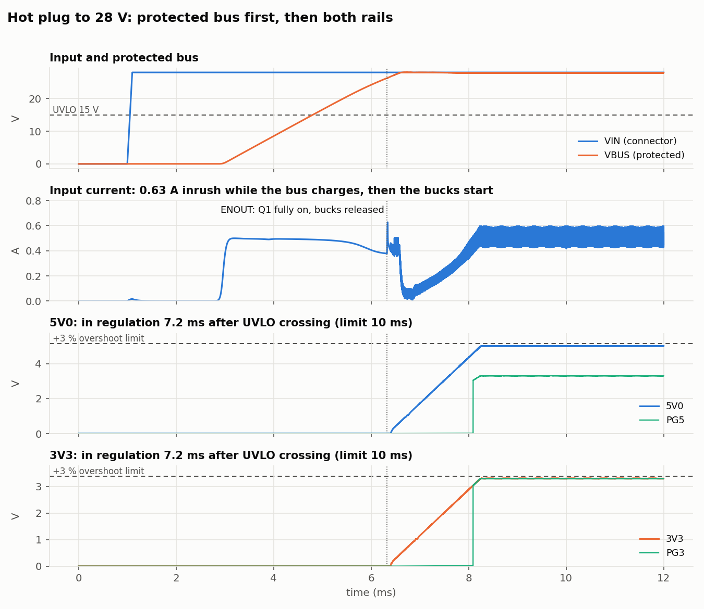
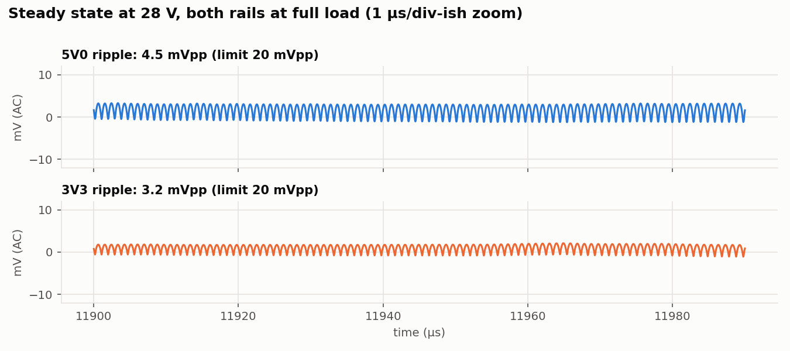
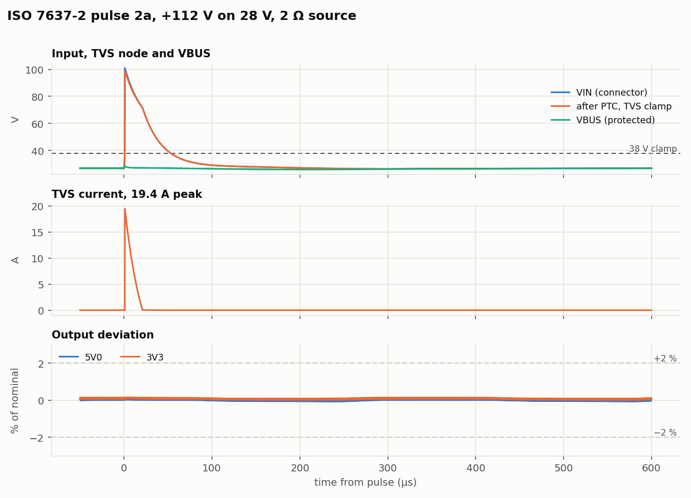
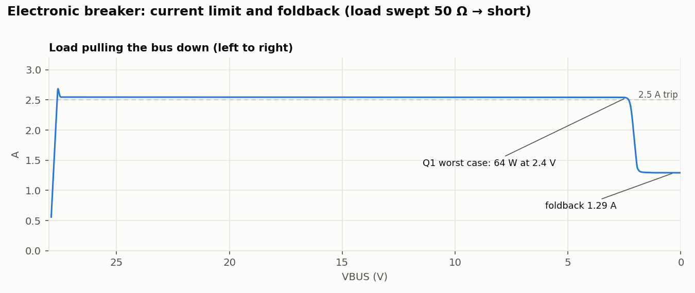
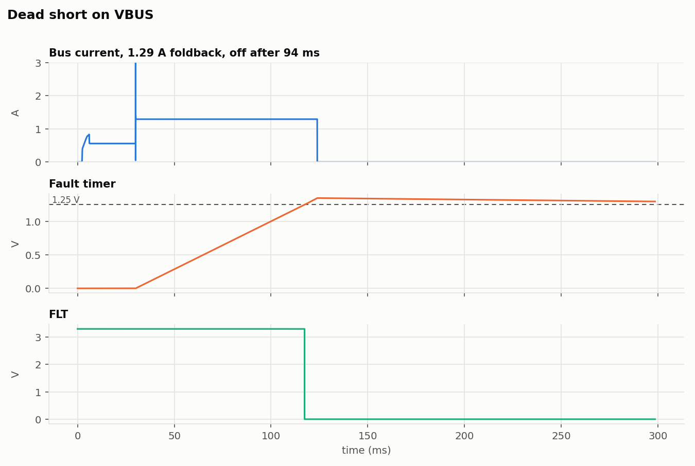
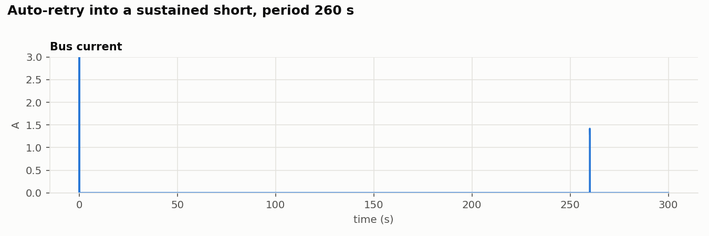
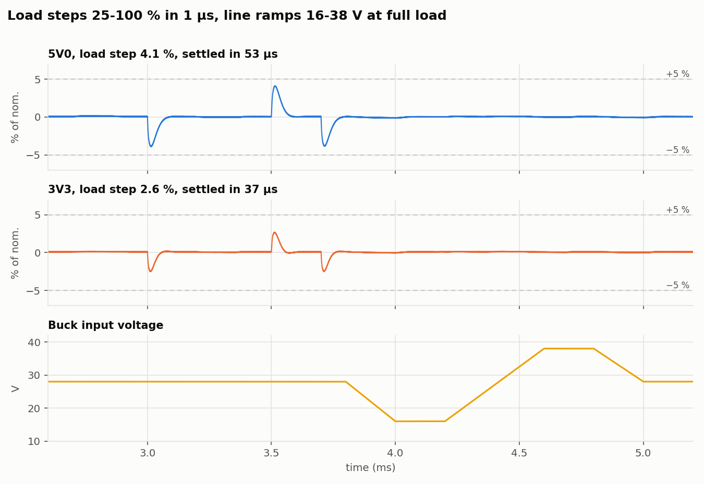

# Simulation

The spec lines in [01-spec.md](01-spec.md) that can be checked before hardware
are verified in LTspice. The models are Analog Devices' LTC4364-2, LT8641 and
LTC6101 models and Infineon's FET models.

```
python sim/run.py            # all ten benches, about 10 minutes
python sim/run.py loaddump   # one bench
python sim/run.py --reuse    # re-analyse existing .raw files
```

`sim/run.py` builds each netlist from `calc/sizing.json`, runs LTspice in batch
mode, measures the waveforms against the spec and writes
[`sim/results.md`](../sim/results.md), [`sim/results.json`](../sim/results.json)
and the figures below. The generated `.cir` netlists can be opened directly in LTspice.

## Results

| Area | Check | Simulated | Limit | Result |
|---|---|---|---|---|
| Startup | 5V0 in regulation after UVLO crossing | 7.16 ms | ≤ 10 ms | Pass |
| Startup | 5V0 overshoot | +0.09 % | ≤ 3 % | Pass |
| Startup | 5V0 monotonic (largest dip during rise) | 11.8 mV | ≤ 1 % of rail | Pass |
| Startup | 5V0 starts after input switch is fully on | +0.12 ms after ENOUT | after ENOUT | Pass |
| Outputs | 5V0 ripple at full load | 7.7 mVpp | < 20 mVpp | Pass |
| Outputs | 5V0 DC at 28 V, full load | 5.001 V | 5.00 V ± 2 % | Pass |
| Startup | 3V3 in regulation after UVLO crossing | 7.15 ms | ≤ 10 ms | Pass |
| Startup | 3V3 overshoot | +0.16 % | ≤ 3 % | Pass |
| Startup | 3V3 monotonic (largest dip during rise) | 20.3 mV | ≤ 1 % of rail | Pass |
| Startup | 3V3 starts after input switch is fully on | +0.11 ms after ENOUT | after ENOUT | Pass |
| Outputs | 3V3 ripple at full load | 4.7 mVpp | < 20 mVpp | Pass |
| Outputs | 3V3 DC at 28 V, full load | 3.303 V | 3.30 V ± 2 % | Pass |
| Outputs | Efficiency, 28 V in, both rails full load | 94.9 % (13.31 W / 14.02 W) | ≥ 85 % | Pass |
| Input | Inrush peak (bus caps charging) | 0.63 A | < 2.5 A breaker | Pass |
| Telemetry | IIN_MON reading vs actual bus current | 0.500 A vs 0.500 A (-0.0 %) | ± 3 % | Pass |
| Telemetry | Highest voltage on any telemetry pin | 2.50 V | ≤ 3.3 V (+0.3 V) | Pass |
| Input | Pulse 2a: TVS clamp (FET drain) | 98.9 V, 19.4 A peak | Q1 ≤ 150 V | Pass |
| Input | Pulse 2a: protected bus peak | 28.3 V | ≤ 39 V | Pass |
| Input | Pulse 2a: LTC4364 VCC peak | 39.6 V | ≤ 80 V (100 V abs max) | Pass |
| Input | Pulse 2a: 5V0 during the spike | 4.996–5.005 V (0.10 %) | ± 2 % | Pass |
| Input | Pulse 2a: 3V3 during the spike | 3.300–3.305 V (0.16 %) | ± 2 % | Pass |
| Input | Load dump: bus clamp | 38.09–38.09 V | 38 V ± 1 V | Pass |
| Input | Load dump: bus never drops out | min 27.3 V | ≥ 16 V (rails' range) | Pass |
| Input | Load dump: fault timer margin | TMR peak 0.81 V | < 1.25 V fault threshold | Pass |
| Input | Load dump: FLT stays high | min 3.30 V | > 2 V | Pass |
| Input | Turn-on threshold (UVLO rising) | 15.59 V | 15 V ± 1 V | Pass |
| Input | Turn-off threshold (UVLO falling) | 14.97 V | below turn-on | Pass |
| Input | Reverse polarity −30 V: current drawn | 10.1 mA | < 15 mA (Rev B) | Pass |
| Input | Reverse polarity: bus voltage | 0.0 mV | ≈ 0 (loads never see it) | Pass |
| Input | Electronic breaker trip current | 2.54 A | 2.5 A ± 20 % | Pass |
| Input | Folds back into a dead short | 1.29 A | < trip current | Pass |
| Input | Dead short: fault timer turns Q1 off | after 94 ms (3.4 J) | turns off | Pass |
| Input | Dead short: FLT asserts | 87 ms after short | asserts | Pass |
| Input | Dead short: auto-retry | every 260 s | retries | Pass |
| Outputs | 5V0 load step 25 → 100 % → 25 % | 4.07 %, settled in 53 µs | < ± 5 %, < 200 µs | Pass |
| Outputs | 5V0 across 16–38 V input at full load | 4.945–5.007 V (1.10 %) | ± 2 % | Pass |
| Outputs | 3V3 load step 25 → 100 % → 25 % | 2.64 %, settled in 37 µs | < ± 5 %, < 200 µs | Pass |
| Outputs | 3V3 across 16–38 V input at full load | 3.294–3.306 V (0.19 %) | ± 2 % | Pass |
| Outputs | 5V0 short circuit and release | 5.6 A peak; recovers in 0.05 ms, peaks at +2 % | recovers, peak ≤ 110 % | Pass |
| Outputs | 3V3 short circuit and release | 5.6 A peak; recovers in 0.07 ms, peaks at +9 % | recovers, peak ≤ 110 % | Pass |

The simulated efficiency is higher than a real board will reach. The LT8641
datasheet curves for these operating points indicate 88-90 %, which still
meets the 85 % requirement.

## What simulation changed

| Item | Rev A | Rev B | Reason |
|---|---|---|---|
| Q1 | IPD200N15N3 (DPAK) | IPB072N15N3 (D²PAK) | Current-limit foldback only starts below 2.4 V on VBUS. A fault holding VBUS just above that point dissipates about 64 W in Q1 until the timer expires. Estimated junction temperature: 193 °C (DPAK), 130 °C (D²PAK). |
| C_TMR | not sized | 6.8 µF | Sets both the load-dump ride-through and the overcurrent cut-off. TMR reaches 0.81 V of the 1.25 V threshold in the load dump; the worst fault pulse is limited to about 100 ms. |
| LT8641 FB reference | 0.800 V | 0.809 V | Measured on the vendor model. Rev A dividers would have set both rails 1.1 % high. Dividers are now E192 0.1 % values. |
| C_FF | 4.7 pF | 22 pF | The 5 V load step was -6.1 % / +6.4 %. With 22 pF it is 4.07 %. |
| Pulse 2a amplitude | 112 V | 112 V above 28 V | ISO 7637-2 adds the pulse to the supply voltage. TVS peak current is 19.9 A instead of 11.8 A, within rating. |

The reverse-polarity current limit was changed from < 1 mA to < 15 mA. With
the input reversed, the LTC4364 conducts about 10 mA from GND to SOURCE
internally (see the Rev B notes in the spec).

## Benches

### Startup (`system`)

The input steps from 0 to 28 V in 100 µs with both rails at full load. The
2.2 nF HGATE capacitor sets the Q1 gate ramp to about 8 V/ms, which limits
inrush to 0.63 A. ENOUT enables both bucks once Q1 is fully on, and the bucks
soft-start in about 2 ms.





### Load dump (`loaddump`)

58 V through 1 Ω for 400 ms with a flat top, which is more severe than the
decaying pulse in the standard. The bucks are replaced by a constant-power load
of 15.6 W (13.3 W output at 85 % efficiency). The `bucks` bench separately
shows both rails in regulation over the full 16-38 V range that the front end
can deliver. Q1 dissipates 8.0 W during the surge and TMR reaches 0.81 V.


### Pulse 2a (`pulse2a`)

The full system is started and then subjected to ISO 7637-2 pulse 2a. D1
clamps the input and the LTC4364 turns Q1 down, so VBUS peaks at 28.3 V. The
1 kΩ / 100 nF filter on the LTC4364 VCC pin keeps VCC below 40 V, so the 62 V
zener does not conduct.



### Electronic breaker (`overload`, `short`, `partial`)

The load is swept from 50 Ω to a short. The LTC4364 limits at 2.54 A and
folds back to 1.29 A below about 2.4 V on VBUS. Maximum Q1 dissipation occurs
just above the foldback point, at full current limit with about 25 V across
Q1. This operating point sets the Q1 selection.



With a sustained short, the fault timer turns Q1 off after 94 ms and FLT goes
low. The LTC4364-2 retries after 32 TMR cycles (about 38 s per µF of C_TMR),
so a sustained short produces one 3.4 J pulse in Q1 every 260 s.





### Undervoltage lockout (`uvlo`) and reverse polarity (`reverse`)

A slow ramp to 20 V and back measures the turn-on and turn-off thresholds.
With the input reversed, VBUS stays at 0 V and the input current is the
LTC4364's internal 10 mA.


### Load steps and line range (`bucks`)

Both bucks with an ideal input: 25 to 100 % load in 1 µs and back, then the
input ramped 28 to 16 to 38 to 28 V at full load. The 60 V/ms line ramp is
faster than anything the front end passes through.



### Output short (`railshort`)

Each rail is shorted for 1 ms with the other at full load, then released. The
LT8641 limits inductor current and both rails recover within 70 µs. On release
the 3.3 V rail overshoots to about 3.6 V (+9 %) for about 30 µs while the
inductor current decays. The spec does not cover this case, and 3.6 V is below
the 4.0 V absolute maximum of an STM32. A third output capacitor on the 3.3 V
rail would reduce it.


## Model limitations

- **Self-heating:** the VDMOS models run at 27 °C. Q1 junction temperature in
  the derating sheet is estimated from the simulated power waveform.
- **PTC trip:** thermal, on a time scale of seconds; F1 is modelled as 0.1 Ω.
  The electronic breaker acts first in every bench.
- **TVS:** written from the datasheet table, using the worst-case
  (highest-clamping) part.
- **Ceramic capacitors:** modelled at their capacitance under DC bias. A 22 µF
  10 V X7R 1210 at 5 V is modelled as 13 µF.
- **Layout:** switch-node ringing, ground bounce and EMI require a PCB.
