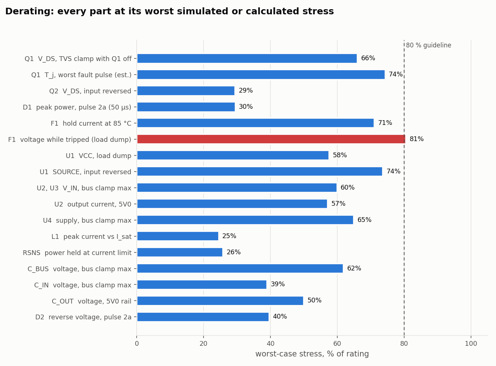

# Derating

The spec asks for every part to run at 80 % of its rating or less at worst case.
This sheet takes each part's worst stress, from [`calc/sizing.json`](../calc/sizing.json)
or the LTspice suite ([`sim/results.json`](../sim/results.json)), and divides by
the rating. [`calc/derating.py`](../calc/derating.py) produces both the table and the chart.

| Ref | Part | Stress | Worst case | Rating | Use |
|---|---|---|---|---|---|
| Q1 | IPB072N15N3 | V_DS, TVS clamp with Q1 off | 99.1 V | 150 V | 66% |
| Q1 | IPB072N15N3 | T_j, worst fault pulse (est.) | 130 °C | 175 °C | 74% |
| Q2 | BSC060N10NS3 | V_DS, input reversed | 29.5 V | 100 V | 29% |
| D1 | SMCJ58CA | peak power, pulse 2a (50 µs) | 1.98 kW | 6.7 kW * | 30% |
| F1 | MF-RX250/72 | hold current at 85 °C | 0.978 A | 1.375 A | 71% |
| F1 | MF-RX250/72 | voltage while tripped (load dump) | 58 V | 72 V | 81% |
| U1 | LTC4364 | VCC, load dump | 57.6 V | 100 V | 58% |
| U1 | LTC4364 | SOURCE, input reversed | 29.5 V | 40 V | 74% |
| U2, U3 | LT8641 | V_IN, bus clamp max | 39 V | 65 V | 60% |
| U2 | LT8641 | output current, 5V0 | 2 A | 3.5 A | 57% |
| U4 | LTC6101 | supply, bus clamp max | 39 V | 60 V * | 65% |
| L1 | SRP7028A-4R7M | peak current vs I_sat | 2.46 A | 10 A * | 25% |
| RSNS | 20 mΩ 1206 | power held at current limit | 0.129 W | 0.5 W * | 26% |
| C_BUS | 47 µF 63 V hybrid | voltage, bus clamp max | 39 V | 63 V | 62% |
| C_IN | 1 µF / 4.7 µF 100 V X7R | voltage, bus clamp max | 39 V | 100 V | 39% |
| C_OUT | 22 µF 10 V X7R | voltage, 5V0 rail | 5 V | 10 V | 50% |
| D2 | BAS21 | reverse voltage, pulse 2a | 99.1 V | 250 V | 40% |

Ratings marked * are from memory of the datasheets' ratings tables. analog.com
refused automated downloads from the build machine, so they still need a pass
against the PDFs before release. The rest are on the parts' first pages.

## Q1 junction temperature

LTspice's FET models don't self-heat, so Q1's junction temperature comes from
the simulated power waveform and a two-number thermal model. The die drop is
P × R_th(j-c), with R_th(j-c) taken from the rated P_tot. On top of that, the
tab and the copper within a few millimetres soak up the pulse energy over its
~100 ms. The worst pulse is the partial short (bench `partial`):

| | Worst pulse | R_th(j-c) | Tab + copper | T_j at 85 °C ambient |
|---|---|---|---|---|
| **IPB072N15N3 G** (D²PAK, used) | 64 W, 6.6 J, 103 ms | 0.5 K/W | 0.5 J/K | **130 °C** |
| IPD200N15N3 G (DPAK, Rev A) | same | 1.0 K/W | 0.15 J/K | 193 °C |

For comparison, the load dump is 8.0 W, 3.23 J spread over 400 ms, and a dead short is 32 W for 94 ms (3.4 J).

This is an estimate good to perhaps ±30 %. Even at the pessimistic end the
D²PAK stays below 175 °C and the DPAK doesn't, which is the decision it
needed to support. The upgrade path is Infineon's Z_th(j-c) curve plus a
board-level thermal sim once the layout exists.

## Lines worth a second look

- **F1 voltage while tripped.** If the PTC has tripped when a load dump arrives,
  it holds off the full 58 V: 81 % of its 72 V rating. That's a fault on top of
  a fault, so I'm leaving it.
- **D1 standoff.** The 58 V standoff equals the load-dump level by design. Its
  breakdown is 64.4 V minimum, so it doesn't conduct during the surge, but it
  leaks more there than at 28 V. Pulse power, the stress that actually wears a
  TVS, is the line in the table.
